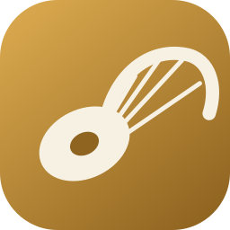

# NexageApps

**Independent software studio building simple, privacy-first products.**

[Products](#-products) · [SAP & Enterprise AI](#-sap-and-enterprise-ai) · [Learning](#-learning-resources) · [Connect](#-connect)

---

> Software should not always need a cloud account, a constant internet connection, or personal data to be useful.

 

##  Products

| Product | What it is |
| --- | --- |
|  **[Yaazh](https://www.nexageapps.com/apps/yaazh/)** | Local Voice AI studio for cloning a voice you have permission to keep and generating speech on your machine. |
|  **[Kiara](https://www.nexageapps.com/apps/kiara/)** | Offline money manager and budget tracker with on-device categorisation. |
|  **[intwise](https://www.nexageapps.com/intwise/)** | Private nearby network. Connect over Bluetooth, exchange selected details with mutual approval, and chat without mobile data, Wi-Fi, or a cloud account. |

 

##  SAP and Enterprise AI

*Read-only by design. Agents here never send, change, approve, or cancel anything.*

| Repo | What it does | Stack |
| --- | --- | --- |
| **[successfactors-mcp-showcase](https://github.com/nexageapps/successfactors-mcp-showcase)** | a landing page and live demo for a read-only MCP server in front of SAP SuccessFactors. The public demo uses a synthetic Employee Central tenant (DEMOCO), not a customer system. |   |
| **[successfactors-mcp-cursor](https://github.com/nexageapps/successfactors-mcp-cursor)** | a Cursor plugin that talks to that MCP server. |   |
| **[joule-career-coach-agent](https://github.com/nexageapps/joule-career-coach-agent)** | a read-only agent that turns an employee's own SuccessFactors record into a short career story: strengths, skill gaps, and two or three next steps. [SAP Community blog](https://community.sap.com/t5/artificial-intelligence-blogs-posts/successfactors-already-knows-your-career-story-here-s-how-i-built-the-joule/ba-p/14522283). |   |
| **[joule-po-followup-agent](https://github.com/nexageapps/joule-po-followup-agent)** | a read-only Joule Studio assistant for buyers. It flags open purchase orders that need follow-up, ranks them by urgency and value, summarises why each one is on the list, and drafts a polite supplier email for the buyer to review. It never sends, changes, approves, or cancels anything. [SAP Community blog](https://community.sap.com/t5/artificial-intelligence-blogs-posts/build-a-joule-procurement-follow-up-agent-in-joule-studio/ba-p/14522351). |   |

 More on the security boundary: [Your AI Agent Wants to Talk to SuccessFactors: Start with the Security](https://community.sap.com/t5/artificial-intelligence-blogs-posts/your-ai-agent-wants-to-talk-to-successfactors-start-with-the-security/ba-p/14469334).

 

##  Learning Resources

| Repo | What it does | Stack |
| --- | --- | --- |
| **[AI](https://github.com/nexageapps/AI)** | an open (MIT) AI engineering curriculum, from ML fundamentals to RAG, agents, and deployment. |   |
| **[LLM](https://github.com/nexageapps/LLM)** | notebooks for building GPT-style language models from the fundamentals. |   |
| **[EthicsClassifierModel](https://github.com/nexageapps/EthicsClassifierModel)** | a fine-tuned DistilBERT model that classifies AI ethics course content into nine topic labels. |  |
| **[simple-nn-from-scratch](https://github.com/nexageapps/simple-nn-from-scratch)** | a small neural network written in NumPy. |   |

 

##  Connect

